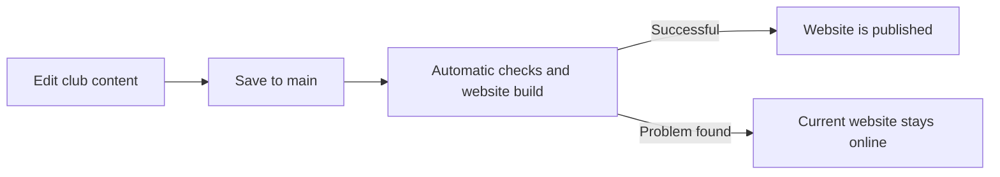

# Jungfrau-Tächi website

This repository contains the files that make up the club website. The public website is [jungfrautaechi.github.io](https://jungfrautaechi.github.io/).

## How the website works

The website has two kinds of files:

- **Club content**: news, photo reports, dates, text and images. These can be maintained through the club’s editing forms.
- **Website features and design**: navigation, page layouts, panorama viewer and other interactive parts. These are maintained in the website code and should be changed with help from a developer.

When a change is saved to the production branch, GitHub checks and prepares the website, then publishes it automatically if the checks succeed:



A successful save is not the same as a successful publication. For important edits, check the latest **Deploy GitHub Pages** run and then look at the live page.

## Editing club content

Use [Pages CMS](https://app.pagescms.org/jungfrautaechi/jungfrautaechi.github.io/main/collection/news) to edit news, photo reports and the annual programme. Sign in with GitHub and select the club repository on the **main** branch. You need editing access; if the forms say you do not have permission, ask a repository administrator to grant access.

- News and photo reports can be saved as drafts while they are being prepared.
- Photo reports can use one folder of pictures; the site builds the gallery from the images in that folder.
- Annual programme changes appear on the site after the automatic checks and publication finish.

The step-by-step instructions, including image preparation, are in the [Pages CMS guide](docs/pages-cms-guide.md). The [news and photo report guide](docs/content-admin-guide.md) explains the file-based alternative.

## Where things live

- `src/` contains the page design and interactive features. Most routine article and event updates do not require changing these files.
- `docs/` contains practical editing and technical reference guides.
- `public/` holds images and other files delivered with the website.
- `scripts/` contains the automated tools that prepare and check the site.

The website is published from the public GitHub repository **JungfrauTaechi/jungfrautaechi.github.io**. The **main** branch is the live version. Changes to page design, navigation or code should be reviewed before they are added to `main`; publishing code changes directly can affect the whole website.

## For website maintainers

To run a local preview, install Node.js and run these commands in PowerShell from the project folder:

```powershell
npm install
npm run dev
```

To prepare and check a release:

```powershell
npm test
npm run build:pages
npm run test:pages
```

See [DEPLOYMENT.md](DEPLOYMENT.md) for the maintainer release and rollback process. The regular `npm run build` also prepares an output compatible with the Sites handoff. `npm run inventory` refreshes the records of public pages and image sources; it does not publish or change the live website.
